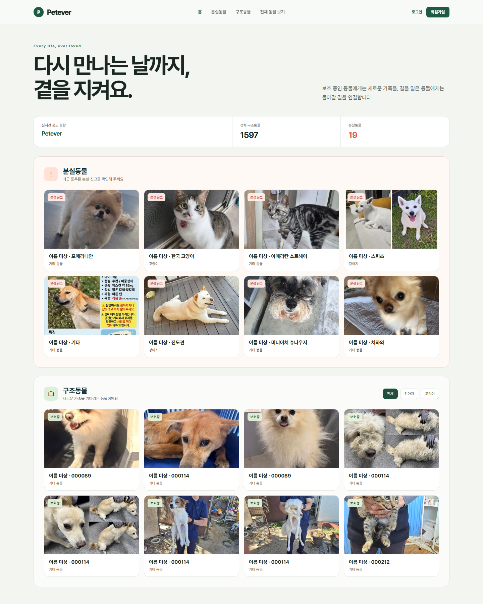

# Petever

> 다시 만나는 날까지, 곁을 지켜요.

Petever는 보호 중인 동물에게 새로운 가족을, 길을 잃은 동물에게 돌아갈 길을 연결하는 서비스입니다. 흩어져 있는 구조동물 공고와 분실동물 신고를 한곳에서 살펴보고 필요한 정보를 빠르게 찾을 수 있습니다.

## 메인 화면

## Petever에서 할 수 있는 일

- 최근 등록된 분실동물 신고를 사진과 함께 확인할 수 있습니다.
- 새로운 가족을 기다리는 구조동물을 한눈에 살펴볼 수 있습니다.
- 구조동물을 전체·강아지·고양이로 나누어 볼 수 있습니다.
- 동물의 사진, 품종, 공고 상태 등 꼭 필요한 정보를 확인할 수 있습니다.
- 전체 동물 목록에서 더 많은 공고를 이어서 탐색할 수 있습니다.

## 구조동물과 분실동물

**구조동물**은 보호기관에서 보호 중이며 새로운 가족을 기다리는 동물입니다. 현재 보호 상태와 사진을 중심으로 소개합니다.

**분실동물**은 가족이 찾고 있는 동물의 신고 정보입니다. 최근 신고를 먼저 보여 주어 빠르게 확인하고 주변을 살펴볼 수 있도록 돕습니다.

